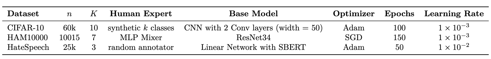

# Learning to Defer with an Uncertain Rejector via Conformal Prediction

Code for *Learning to Defer with an Uncertain Rejector via Conformal Prediction*, published in TMLR in 2026. An earlier version appeared at the NeurIPS 2024 Workshop on Bayesian Decision-making and Uncertainty. [TMLR paper](https://openreview.net/forum?id=SZQJ8K2DUe) · [Workshop paper](https://openreview.net/forum?id=TWb9y4PNSW)

## What is it?

Learning to defer (L2D) allows prediction tasks to be allocated to a human or machine decision maker, thus getting the best of both’s abilities. Yet this allocation decision depends on a'rejector’ function, which could be poorly fit or otherwise misspecified. In this work, we perform uncertainty quantification for the rejector subcomponent of the L2D framework. We use conformal prediction to allow the reject to output sets instead of just the binary outcome of ‘defer’ or not. On tasks ranging from object to hate speech detection, we demonstrate that the uncertainty in the rejector translates to safer decisions via two forms of selective prediction.

As a motivating example, in the diagnosis of skin lesions using the HAM10000 dataset, an abstention indicates that the current data does not provide sufficient confidence for a reliable prediction. In such scenarios, decision-makers can seek further information, such as laboratory tests, to ensure more accurate and safer outcomes.

This strategy aligns with practices in medical diagnostics, where clinicians often require additional data before making definitive decisions, thereby enhancing the reliability of diagnoses and treatments.

## Implementation



The code for §§3.1–3.3 implements deferral sets, deferral intervals and the decision rules that use them. [Deferral sets](conformal/deferral_sets.py) · [Deferral intervals](conformal/deferral_intervals.py)

OvA uses the upstream loss. The training loop saves the final epoch and exposes the logits for conformal calibration. A-SM uses Eq. (6) to estimate expert correctness. Dataset loaders, networks and experts build on two upstream implementations. [human_ai_deferral](https://github.com/clinicalml/human_ai_deferral/tree/94c05bcdb6822009835fe051dc11a0a878f3e6f4) · [Multi_L2D](https://github.com/rajevv/Multi_L2D/tree/3f2ad6bc93afdfd250faac21225f6b55074b6cf8)

## Quick start

Run clean CIFAR-10 with OvA. The first run downloads the data and trains the model.

```bash
git clone https://github.com/yizirui/conformal_L2D.git
cd conformal_L2D
conda env create -f environment.yml
conda activate deferral
python -m experiments.run --config configs/cifar10.yaml --name quickstart --max-severity 0
```

The results are in `output/expers/quickstart/SimpleCNN/ConformalAndThreshold/OvA/seed_42/alpha_0.1/metrics.csv`.

## Paper experiments

Prepare the inputs for your dataset, then run the corresponding command from the repository root. [Data preparation](docs/data.md)

| Experiment | Command |
| --- | --- |
| CIFAR-10 deferral sets, including SVHN at level 6 | `python -m experiments.run --config configs/cifar10.yaml` |
| CIFAR-10 deferral intervals, levels 0–5 | `python -m experiments.run --config configs/cifar10_intervals.yaml` |
| HAM10000 deferral sets | `python -m experiments.run --config configs/ham10000.yaml` |
| Hate Speech deferral sets | `python -m experiments.run --config configs/hate_speech.yaml` |

All four configurations default to OvA, seed 42 and `alpha=0.1`. Add `--surrogate ALCE` for A-SM (CUDA required). The runner trains on D1 for the Table 3 epoch count, saves the final weights, and calibrates on held-out D2. Use `--seed` for another run or `--training-config` for a custom training configuration. [Table 3 training settings](configs/training.yaml)

## Reading the results

Each `metrics.csv` contains one seed. `source_model` evaluates the base rejector. `cali_by_non_shifted` uses source calibration and `cali_by_shifted` uses target calibration. [CSV columns](configs/columns.json)

| Paper result | Rows and metrics |
| --- | --- |
| Table 1 | On the clean source-calibrated row (`severity=0`), `empirical_coverage` measures inclusion of the observed expert correctness label (`m == y`). `empirical_width` is the mean set size. |
| Table 2 | On clean rows, read `non_abstention_*` and `consensus_*`. Accuracy and deferral rate use answered examples. The fraction answered uses the full test set. |
| Figure 2 | Compare OvA with source and target calibration and A-SM with target calibration, starting from each surrogate’s clean row. The `human_preferred_*` columns use all examples. For the CIFAR endpoint, select `corruption=svhn` and `severity=6`. |
| §3.3 intervals | Defer when the lower bound exceeds the largest class probability. Model-preferred routes a full `[0,1]` interval to the classifier. `model_preferred_acc` uses all examples. |

# Citation

```
@article{
fang2026learning,
title={Learning to Defer with an Uncertain Rejector via Conformal Prediction},
author={Yizirui Fang and Eric Nalisnick},
journal={Transactions on Machine Learning Research},
year={2026},
url={https://openreview.net/forum?id=SZQJ8K2DUe},
note={}
}

@inproceedings{fang2024learning,
  title={Learning to Defer with an Uncertain Rejector via Conformal Prediction},
  author={Fang, Yizirui and Nalisnick, Eric},
  booktitle={NeurIPS 2024 Workshop on Bayesian Decision-making and Uncertainty},
  year={2024}
}
```
